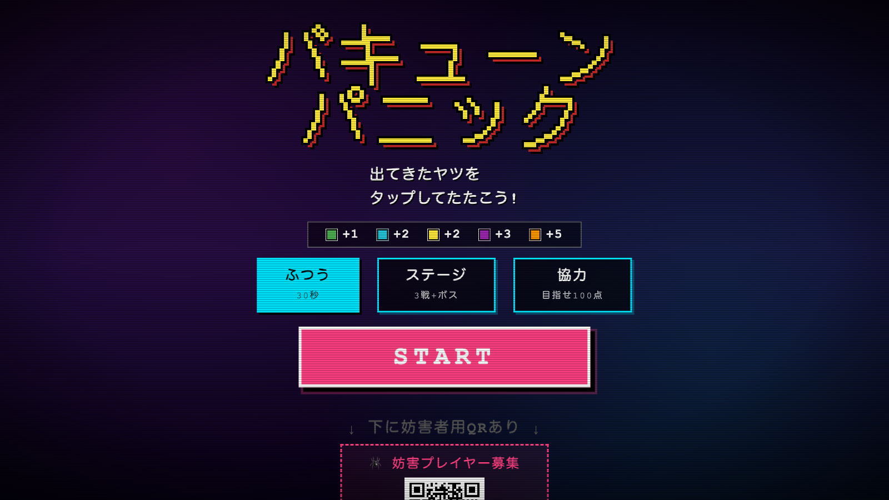

# バキューンパニック (AIワニワニパニック)



出てきたキャラをタップしてたたく、もぐらたたき風のゲーム。
AI がプレイの様子を見て、出し方を変えたり新しいキャラを作ったりする。
スマホから参加できる「コントローラー」と「妨害」の画面つき。

2026年4月 Project DENT ハッカソン(第3ラウンド)で作成。

## 動かし方

```
python3 server.py
```

- 本体: http://localhost:8767/
- コントローラー: http://localhost:8767/controller.html
- 妨害: http://localhost:8767/sabotage.html

AI を使うときは環境変数 `GEMINI_API_KEY` を設定する。
新キャラの絵は画像生成サーバー(Flux, `localhost:8888`)を使う。
どちらもなくても遊べる。
